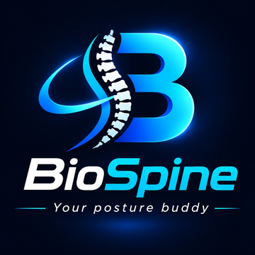

# BioSpine: User Manual

BioSpine helps you sit and stand with better posture. A small sensor on your neck gives you a alarm when you slouch,
and the website turns good posture into points, streaks and badges, reminds you to take back breaks, and shows your progress.

## 1. Getting in

1. Open the BioSpine website: **[your website address]**
2. Click **Sign In / Get Started**.
3. New here? Choose **Create account** and enter your email, a password, and your **height (cm)** and **weight (kg)**.
   Your BMI appears as you type.
4. Already have an account? Enter your email and password and sign in.
5. Just looking around? Click **Try the live demo**. No account or sensor is needed.

If a yellow bar asks you to confirm your email, open the message we sent you and click the link. Not there? Press
**Resend email** and check your spam folder.

You can install BioSpine on your phone like an app: open the website in Chrome and choose **Add to Home screen**.

## 2. First-time setup (2 minutes)

1. Go to **My Device**.
2. **Step 1, Connect:** press **Bluetooth** or **USB cable**. No sensor yet? Press **Start demo data**.
3. **Step 2, Set your good posture:** sit up tall and relaxed, press **Save my good posture**, and hold still for 3 seconds.
4. **Step 3, Check you can hear it:** press **Test the alarm sound**. You should hear the alarm.

Bluetooth works in Chrome or Edge on Android and computers. iPhone browsers do not support it, but you can still use the demo and see your reports.

## 3. A normal day

- Wear the sensor and open **Dashboard**. It shows your posture live, your score, and how hard your neck is working.
- If you slouch for a few seconds, an alarm sounds and the screen shows a reminder. Sit up and it stops.
- Press **Floating mini-window** to keep a tiny posture light on top of your other windows.
- Pick your style in **Settings**: **Focus Mode** (alarm after 3 seconds of slouching), **Meeting Mode** (silent, on-screen reminders only) or **Training Mode** (stricter).

## 4. What each page does

| Page | What you can do there |
|---|---|
| **Dashboard** | Watch your live posture, today's goal and your recent trend. |
| **Rewards & Quests** | See your level and XP, finish daily quests, and collect badges. |
| **Back Break** | Get reminders every 30 minutes to 2 hours and follow 1-minute stretches. Switch on **Meeting-friendly mode** for silent reminders. |
| **Posture Lab** | Drag the slider to see what leaning does to your neck, check your desk set-up, and take a short quiz. |
| **My Progress** | See your last 7 days and what kind of slouching happens most. |
| **Session History** | Read **My report** in plain words and download it as **PDF** or **Excel**. |
| **My Device** | Connect, set your good posture and test the alarm sound. |
| **Settings** | Change how strict BioSpine is, the alarm sound and volume, your height and weight, and your daily goal. |
| **Chats with AI Physio** | Ask posture questions (only if the AI feature is switched on). |

## 5. Earning points

- Every minute you sit well earns XP, and higher scores earn more.
- Finish the 4 **daily quests**: wear it for 30 minutes, score 80% or more, take a back break, finish the quiz.
- Keep your **streak** going by scoring 60% or more each day.
- Badges unlock as you go. Level up and enjoy the confetti.

## 6. Handy tips

- **Light or dark:** use the sun / moon button at the top.
- **Slow device or low battery?** Press **⚡ Performance mode**. It turns off the animated background. Press it again to turn it back on.
- **Back breaks in a meeting:** set **Back Break** to Meeting-friendly mode. You get a small silent note instead of a sound.
- **Leaning more than 60 degrees:** the Posture Lab and Dashboard show a **Very huge load** warning. Sit up and lift your chin.
- After your 5th saved session we will ask once for a quick review. Your email is never shown.

## 7. Tell us what you think

Press **⭐ Write a review** at the bottom of the left menu any time. You can come back later and change your review.

## 8. Your data

- You can download your data or delete your account any time in **Settings**.
- BioSpine is a wellness tool and not a medical device. BMI and posture numbers are rough guides, not a diagnosis.
  If you have pain, please see a doctor or physiotherapist.

---
*For developers and hosting, see `DEPLOY.md`.*
